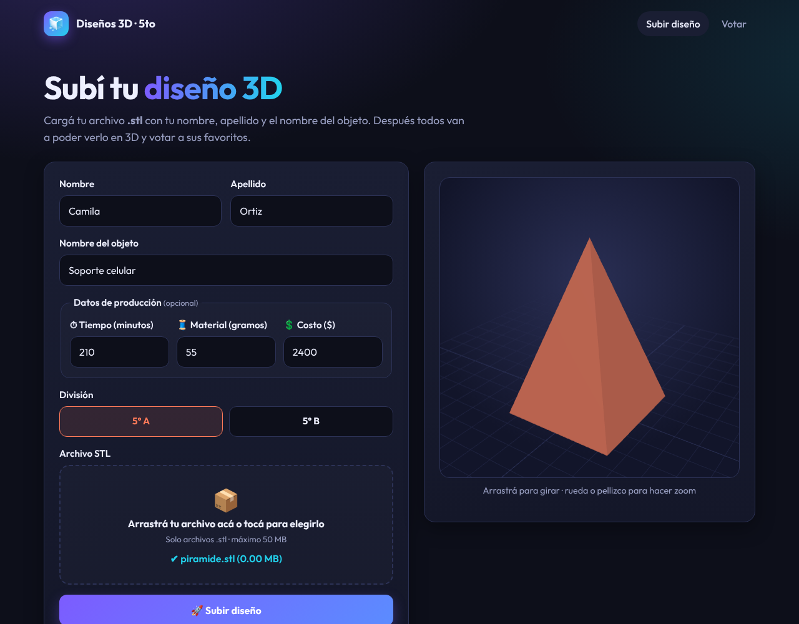
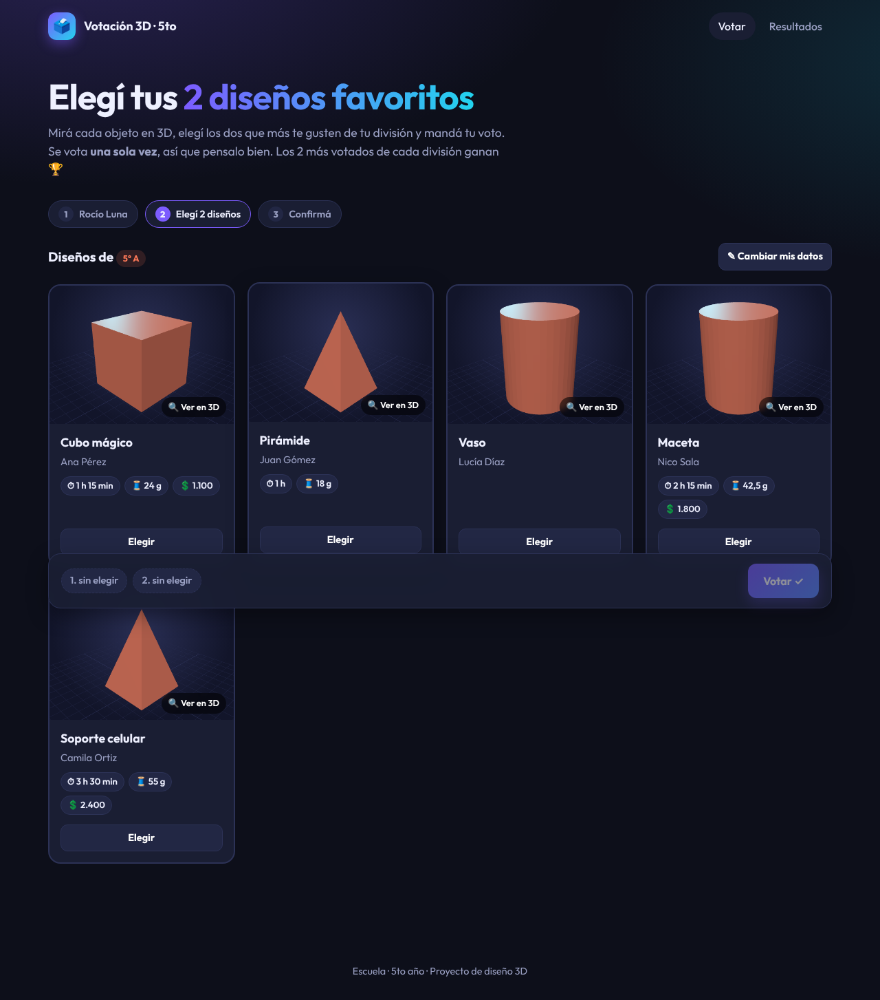
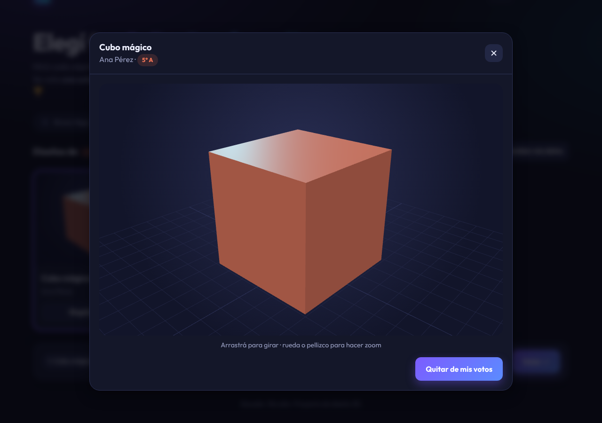
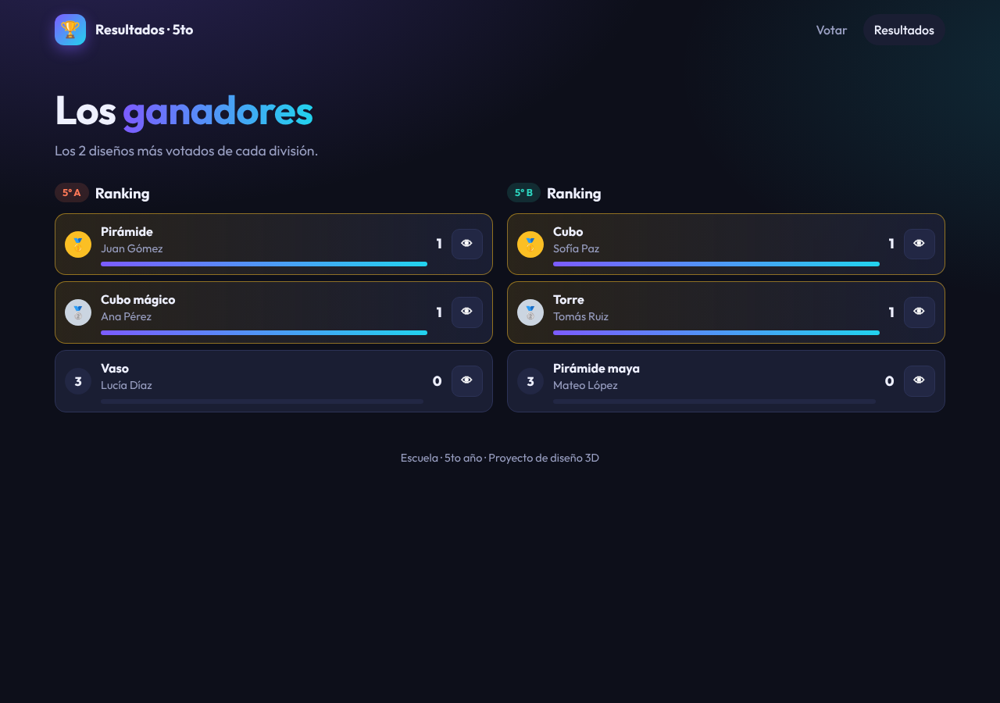
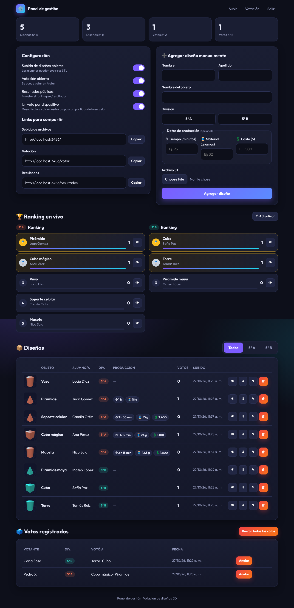
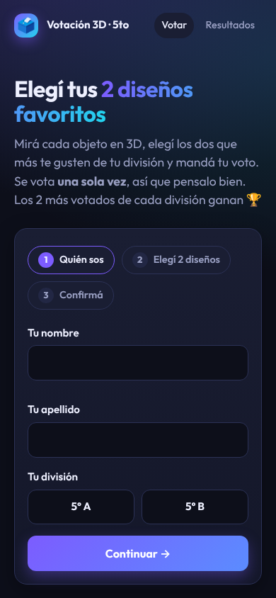

# 🧊 Votación de diseños 3D · 5to año

Aplicación web para que los alumnos de 5to (divisiones **A** y **B**) suban sus archivos **STL** y después se vote a los mejores, con visor 3D integrado.

| Página | Link | Para qué |
|---|---|---|
| Subida | `/` | Cada alumno sube su `.stl` con nombre, apellido, nombre del objeto y división (y opcionalmente los datos de producción) |
| Votación | `/votar` | Se ven todos los diseños en 3D y cada alumno elige **2** de su división (vota una sola vez) |
| Resultados | `/resultados` | Ranking público con los 2 ganadores por división (se activa desde el panel) |
| Panel | `/admin` | Gestión protegida con contraseña |

## Capturas

| Subida | Votación | Visor 3D |
|---|---|---|
|  |  |  |

| Resultados | Panel | Celular |
|---|---|---|
|  |  |  |

## Reglas de votación

- Cada persona vota **una sola vez** y elige **exactamente 2 diseños** de **su propia división**.
- No se puede votar el propio diseño.
- Se controla por nombre + apellido + división (sin importar mayúsculas ni tildes) y, opcionalmente, un voto por dispositivo.
- Ganan los **2 más votados de cada división**. Si hay empate en el 2° puesto, el panel lo avisa.

## Datos de producción

Cada diseño puede tener, cargados a mano y opcionales:

- ⏱ **Tiempo** de impresión en minutos (se muestra como "2 h 15 min")
- 🧵 **Material** utilizado en gramos
- 💲 **Costo** de producción en pesos

Se cargan al subir el diseño o desde el panel (al agregar o editar un diseño), y se muestran en las tarjetas de votación, en el visor 3D y en el panel.

## Panel de gestión (`/admin`)

- Abrir/cerrar la subida y la votación, publicar resultados.
- Activar/desactivar "un voto por dispositivo" (desactivalo si votan desde las compus compartidas de la escuela).
- Agregar diseños manualmente, editar datos (incluidos tiempo, material y costo), ver en 3D, descargar y eliminar.
- Ranking en vivo, lista de votantes, anular votos individuales o borrar todos.
- Links para compartir listos para copiar.

## Correr localmente

```bash
npm install
ADMIN_PASSWORD="una-clave-segura" npm start
# http://localhost:3000
```

Variables de entorno:

| Variable | Default | Descripción |
|---|---|---|
| `ADMIN_PASSWORD` | `admin5to` | Contraseña del panel. **Cambiala siempre.** |
| `PORT` | `3000` | Puerto |
| `DATA_DIR` | `./data` | Dónde se guardan `db.json` y los STL subidos |
| `MAX_FILE_MB` | `50` | Tamaño máximo por archivo |
| `BLOB_READ_WRITE_TOKEN` | — | Si está, usa Vercel Blob en vez del disco (Vercel lo crea solo al conectar el Blob Store) |

## Publicarlo en internet

### Vercel (recomendado)

En Vercel no hay disco, así que los STL y los datos (diseños, votos, configuración) se guardan en **Vercel Blob**. Los archivos se suben directo desde el navegador a Blob, así que no hay límite de 4,5 MB.

1. Importar el repo en Vercel (Add New → Project). `vercel.json` ya tiene todo configurado.
2. En el proyecto: **Storage → Create → Blob** y conectarlo al proyecto (crea `BLOB_READ_WRITE_TOKEN`).
3. Agregar la variable `ADMIN_PASSWORD` y volver a desplegar.

### Servidor propio / Render / Railway

Sin `BLOB_READ_WRITE_TOKEN`, la app guarda todo en disco (`DATA_DIR`). Hace falta disco persistente.

- **Render** (incluye `render.yaml`): New → Blueprint → elegir este repo → cargar `ADMIN_PASSWORD`.
- **Railway**: agregar un Volume montado en `/data` y las variables `DATA_DIR=/data` y `ADMIN_PASSWORD`.
- Cualquier compu con Node 20+: `npm install && npm start`.

## Estructura

```
server.js            API (Express)
lib/store.js         Datos: JSON local o Vercel Blob
api/index.js         Entrada para Vercel
scripts/vendor.js    Copia Three.js y el cliente de Blob a public/vendor
public/index.html    Subida
public/votar.html    Votación
public/resultados.html
public/admin.html    Panel
public/js/stl.js     Visor 3D y miniaturas (Three.js, servido localmente)
```
